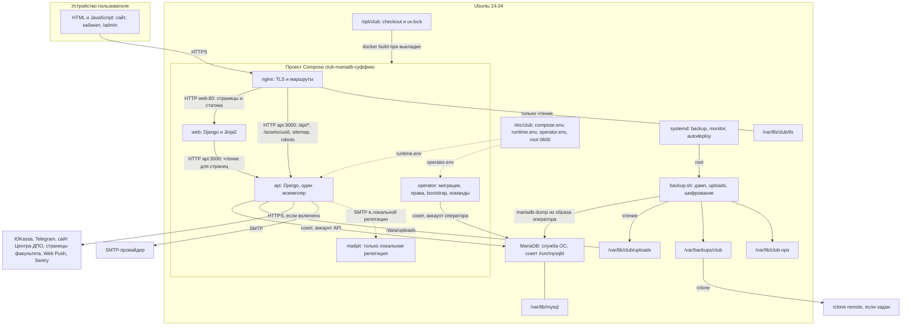

# Архитектура Клуба

Документ объясняет устройство приложения и рабочего контура. Доказательства
проверок конкретной версии находятся в [project-state.md](../operations/project-state.md), команды -
в [deploy-runbook.md](../operations/deploy-runbook.md), настройки - в [configuration.md](configuration.md).

## Назначение и границы модулей

| Каталог | Ответственность | Чего здесь быть не должно |
|---|---|---|
| `frontend/club_web/templates` | Страницы, оболочки, формы и навигация | Серверных секретов и окончательного решения о цене и правах |
| `frontend/club_web/pages.py`, `client.py`, `browser` | Функции сайта, HTTP-клиенты, состояние и общие преобразования | Прямого доступа к базе, хешей и серверных ключей |
| `backend/club_api/modules` | Маршруты, схемы запросов, права и логика предметных областей | Независимых копий правил расчета |
| `backend/club_api/db`, `core`, `jobs`, `observability` | Данные, общие механизмы, расписание, аудит и настройки | Неявного доверия цене и роли из браузера |
| `data` | Общие справочники и архив дайджеста | Запросов с серверными ключами из общего браузерного кода |
| `backend/club_api/modules/auth` | Создание и проверка хешей паролей только на сервере | Импорта из клиентского приложения |
| `scripts/club_ops` | Миграции, bootstrap, сотрудники, выпускники, импорты и проверочные письма | Сброса контента или паролей пользователя при повторном запуске |
| `scripts/*.sh`, `scripts/lib`, `deploy/systemd` | Установка, обновление, копии, восстановление, мониторинг | Второго несогласованного способа обслуживания |

Маршруты интерфейса выбираются в [pages.py](../../frontend/club_web/pages.py).
Полная карта каталогов и правило выбора модуля - в [структуре проекта](repository-structure.md).
Основные страницы используют `templates/base.html`; Telegram и PWA включают мобильную
оболочку. Общая логика API и расчетов для них одна. Рабочие инструкции собраны в
[навигации документации](../README.md).

## Схема обслуживания

Сайт работает на одном сервере Ubuntu 24.04. MariaDB из пакетов Ubuntu запущена как
служба ОС. API, сайт, nginx и операторский образ запускаются через
[compose.mariadb.yml](../../deploy/compose.mariadb.yml). По
[решению владельца](../decisions/cms-options.md) отдельного Directus нет: auth,
контент и файлы обслуживает Django API, совместимые имена таблиц пользователей,
ролей и файлов сохранены. Прежние схемы с Directus, PostgreSQL и Caddy остались в
истории Git: [до перехода на Django](https://github.com/Bogolubov-creator/hse-law-alumni-club/blob/a03b14174f31ee0821e14a70411979f6d780a844/docs/development/architecture.md)
и [перед удалением PostgreSQL](https://github.com/itspecR/hse-law-alumni-club/blob/a23ad21030cd170f19b7da3e5eb3e2865461328a/docs/development/architecture.md).

nginx публикует HTTP и HTTPS на адресе и портах из `compose.env`: для публичного
домена это 80 и 443, для локальной репетиции и сервера по IP - 9080 и 9443. HTTP
только перенаправляет на `PUBLIC_URL` и отвечает на `/health`. У offsite нет
заранее заданного адреса: протокол и права определяет выбранный rclone remote.
Пустой `BACKUP_OFFSITE_REMOTE` оставляет только локальные копии.

## Сервисы и хранилища

| Компонент | Технология | Размещение и адрес | Внешний доступ | Постоянные данные | Проверка готовности |
|---|---|---|---|---|---|
| Браузер | HTML, CSS и JavaScript | Устройство пользователя | К nginx по HTTPS | Локальное состояние, не основная БД | Сценарий и console |
| Сборка | Docker build, Python и uv | На сервере при выкладке, реестры по HTTPS | Исходящий при сборке | Кэш и образы одной ревизии | Код `0` |
| Прокси | nginx 1.30.6 | Контейнер `nginx`, внутри 8080 и 8443, UID и GID 101 | Порты из `compose.env` | Сертификат из `CLUB_TLS_DIR`, только чтение | `/health` на 8080 |
| Страницы и статика | Django и Jinja2 | `web:80` | Через nginx | Включены в образ | `/health` |
| API | Django, Gunicorn | `api:3000`, один экземпляр | Через nginx | MariaDB и uploads | `/health` - процесс; `/ready` - база и обязательные таблицы |
| База | MariaDB из пакетов Ubuntu | Служба ОС, сокет `/run/mysqld/mysqld.sock`, TCP только на loopback | Нет | `/var/lib/mysql` | `SELECT 1` при старте API, затем `/ready` |
| Оператор | Python и Django | Одноразовый контейнер `operator`, профиль `operator` | Нет входящего порта | Миграции Django, права аккаунта API, начальные данные | Завершение с кодом `0` |
| Почта репетиции | Mailpit | Профиль `local`, `127.0.0.1:8025` | Только loopback | Нет | - |
| Операции | Bash, Python, Docker CLI, systemd | Сервер Ubuntu | Исходящий HTTPS, Docker socket | `/var/backups/club`, `/var/lib/club-ops` | Код завершения, journald, успешная копия |

Выкладка (`deploy.sh`) идет так: проверка конфигурации, базы, места и сертификата;
сборка образов; проверка production-настроек в образе API; загрузка вспомогательных
образов; резервная копия, если API уже работает; остановка записи; в образе
оператора `migrate`, `configure-mariadb-role` и `bootstrap`; запуск `api` и `web`
до состояния healthy; пересоздание `nginx`; проверка TLS, сайта и `/api/ready`;
запись `last-deploy.json`. При ошибке скрипт возвращает прошлый коммит, порядок
описан в [runbook](../operations/deploy-runbook.md#обновление-и-отказ-операции).
`depends_on` задает старт, но не подтверждает пользовательский сценарий.

Лимиты памяти Compose: API 512 MiB, web 256 MiB, nginx и Mailpit по 128 MiB.
MariaDB работает вне Compose, эти лимиты к ней не относятся. Сборка, кэш, ОС и
копии требуют запаса: [capacity.md](../operations/capacity.md); замеры в нем
сделаны на прежней схеме с PostgreSQL и Caddy.

## Данные и файловые потоки

| Домен | Хранилище и владелец записи | Инвариант |
|---|---|---|
| Контент, каталог, страницы | Бизнес-таблицы; внутренний [store.py](../../backend/club_api/db/store.py) | Разрешенные таблицы и поля, модели Django, серверный фильтр публикации |
| Блоки страниц | `pages`, `pages_blocks`, `block_hero`, `block_cta` | Раскрытие только известных типов блоков, порядок sort; не универсальный CMS query engine |
| Пользователи | `directus_users`, `directus_roles`; [service.py](../../backend/club_api/modules/auth/service.py) | UUID пользователей, актуальные status и роль, нет выдачи секретных полей |
| Пароли | Серверный пакет `club_api.modules.auth.passwords` | BCryptSHA256 создает и проверяет хеш; браузер пакет не импортирует |
| Настройки | `club_settings` | `site` - публичный whitelist, его создает bootstrap. У аккаунта API нет доступа к таблице |
| Файлы | `directus_files` и `/var/lib/club/uploads`, путь в API `/data/uploads` | Сохранение UUID и байтов, проверка загрузки, нет общей открытой директории |
| Заявки и склад | `orders`, `club_checkout_*`, каталог; checkout-store | Цена пересчитывается сервером; резерв и запись атомарны |
| Оплата и подписка | orders и alumni; payment-store | Проверка провайдера, связанного ID, суммы и валюты; транзакция и идемпотентность |
| Баллы | `points_ledger`, achievements, кэши alumni | Ledger является журналом начислений; кэш не заменяет его |
| Сессии | `club_auth_revocations`, `club_staff_sessions`, `alumni.token_version` | Отзыв и поколение токенов переживают рестарт |
| Поддержка и очереди | Собственные таблицы `club_*` | Права и сроки хранения определяет API |

Схему базы создают миграции Django из `backend/club_api/db/migrations`; команда
оператора `migrate` применяет их при каждой выкладке. Повторный bootstrap сохраняет
пароли, роли и ручные изменения. Демо-каталог и тестовые аккаунты создаются только
при `SEED_DEMO=true` вне production. Каталог ДПО вручную не импортируется: его
загружает API с сайта Центра ДПО ([dpo-center.md](../integrations/dpo-center.md)).

Медиараздел находится в панели офиса. Публичная выдача изображения требует ссылки
из опубликованного контента, аватар обслуживается отдельным маршрутом, аудио
подкаста - проверкой права и подписанной ссылкой. Путь `/assets/<uuid>` проходит
через API с теми же ограничениями и не открывает каталог uploads. Внешнее медиа не
включается в локальную резервную копию автоматически.

Аватар декодируется до записи. Публичный ответ формирует Pillow: PNG не больше
256×256 с сохранением пропорций, поворотом по EXIF и без исходных метаданных.
Оригинал не меняется. Ограничения: 16 млн пикселей, ожидание результата до трех
секунд, одно преобразование одновременно и до восьми ожидающих, кэш на 64 записи,
16 MiB и пять минут. Другие изображения и аудио офиса этот модуль не преобразует.

## Роли и границы доверия

| Роль | API Клуба | База и обслуживание |
|---|---|---|
| Гость | Опубликованный контент, корзина и доступные формы | Нет прямого доступа к БД |
| Выпускник | Свой кабинет по JWT; часть действий зависит от верификации | Роль alumni не становится сотрудником |
| `editor` | Контент и файлы, обзор, список участников и заявок, смена статуса заявки | Чувствительные операции закрывает `require_full_admin` |
| `admin` и прежняя `Administrator` | Баллы, скидки, выгрузки, верификация, поддержка и прочие операции офиса | Это роль приложения, а не аккаунт MariaDB |
| Аккаунт API в MariaDB | Подключение всех модулей API через сокет | Права только на таблицы и поля API (`configure-mariadb-role`); без создания баз и аккаунтов, без изменения роли пользователя и чтения закрытых настроек |
| Оператор Ubuntu | Миграции, bootstrap, `manage-staff`, копии | Root, Docker socket и аккаунт оператора MariaDB дают контроль над сервером и базой |

Общий слой данных не читает password, token и TFA и не изменяет системные роли.
Нативный auth имеет отдельные узкие запросы хеша, provider и TFA и обновления пароля.
Аккаунт API видит данные всех участников: разграничение между пользователями
проверяет приложение, а не база.

Команда `manage-staff` работает от аккаунта оператора и принимает пароль через stdin
или окружение. Повторное создание не меняет существующий аккаунт; сброс увеличивает
версию служебной сессии. Команда не повышает выпускника до сотрудника и не отключает
MFA. SSO и MFA-аккаунты сохраняются в БД; вход по одному локальному паролю для них
закрыт до отдельного решения о переносе способа входа.

Сессии передаются в `Authorization: Bearer`: alumni - 7 дней, офис - 12 часов.
Офис проверяет текущие status, роль и поколение сессии при каждом запросе. Сброс
пароля alumni увеличивает `token_version`; его обычный logout удаляет токен только
из браузера. Admin logout сохраняет отзыв `jti` в БД. Токены в браузерном хранилище
оставляют риск XSS: [security.md](security.md).

API не публикует порт на сервере: его видят только nginx и web во внутренней сети
Docker. MariaDB принимает TCP только на loopback, контейнеры подключаются через
сокет. Прямой порт API изменил бы доверие к proxy-заголовкам, rate limit и
источнику webhook. CORS ограничивает браузерные origins, но не заменяет
авторизацию. Внешнего входа для начисления баллов нет: баллы начисляются только
через панель управления.

## Фоновые задачи

Источник расписаний API - [runner.py](../../backend/club_api/jobs/runner.py) и
`scheduled()` в [tasks.py](../../backend/club_api/jobs/tasks.py). Все указанные часы
относятся к `Europe/Moscow`. `JOBS_ENABLED=false` останавливает этот набор, включая
запуск polling и регистрацию команд бота при старте. При включенном наборе каждая
задача пропускает новый тик, если ее предыдущий запуск еще выполняется. Блокировка
действует только в одном процессе API.

| Задача | Запуск | Повтор и результат | Отключение |
|---|---|---|---|
| Каталог ДПО с сайта Центра ДПО | В 41-ю минуту каждого часа, если задан `DPO_SITE_URL` | Следующий запуск; при сбое остается прежний список; ручное обновление требует прав администратора | `DPO_SYNC_ENABLED=false` или пустой `DPO_SITE_URL` |
| Напоминания о событиях | Ежедневно 10:00 | Следующий запуск; отметки в данных ограничивают повторы | `JOBS_ENABLED=false` |
| Напоминания о подписке на подкасты | Ежедневно 11:00 | Следующий запуск; флаг отправки в данных | `JOBS_ENABLED=false` |
| Очистка поддержки, заявок, аудита и почтовой очереди | Ежедневно 04:00; поддержка также при старте | Следующий запуск, сроки из конфигурации; письма - 30 дней | `JOBS_ENABLED=false`; сроки меняются отдельно |
| Истечение резервов | Каждые 15 минут | Следующий тик | `RESERVE_TTL_HOURS=0` или `JOBS_ENABLED=false` |
| Почтовая очередь | Каждые 5 минут | До `MAIL_OUTBOX_MAX_ATTEMPTS`, результат в outbox; письма офиса и заявителям | `JOBS_ENABLED=false` |
| Источники новостей | В 17-ю минуту часа, кратного интервалу из панели (1, 3, 6, 12 или 24 часа) | Следующий запуск; новость, которая не загрузилась, ждет его | `NEWS_SYNC_ENABLED=false` или выключатель в панели |
| Telegram polling | Длительный цикл при старте | Повторы описаны в `modules/telegram/bot.py` | Убрать токен, выключить polling или общий набор задач |
| Резервная копия | systemd, ежедневно 03:30 | `Persistent=true` компенсирует пропущенное срабатывание; ошибка в journal и состоянии копии | Отключить только соответствующий timer |
| Мониторинг | systemd: через 5 минут после загрузки, затем каждые 5 минут | Периодический опрос, локальный exit status и journal | Отключить только соответствующий timer |
| Автовыкладка `main` | systemd: каждую минуту | Только при зеленом CI; до 3 попыток на коммит с паузой 5 минут, откат делает `deploy.sh` | Отключить `club-autodeploy.timer` |

Планировщик API пишет идентификатор задачи, статус и длительность. Он не хранит
устойчивую очередь всех календарных запусков: момент, пропущенный при выключенном
API, сам планировщик не воспроизводит. Для критических задач нужны дополнительные
сверки после простоя. Systemd `Persistent=true` дает такую семантику таймеру копий,
но не распространяется на API.

Очистка временных антибрутфорс-счетчиков и карты отозванных JWT выполняется
внутрипроцессными интервалами и не является отдельной хозяйственной задачей.
Подробные команды таймеров, блокировки копий, пороги мониторинга и ответственный -
в [runbook](../operations/deploy-runbook.md).

## Пути и владение

| Путь | Владелец и права | Обслуживание |
|---|---|---|
| `/opt/club` | Код, доступный оператору; рабочие секреты отсутствуют | Только проверенный коммит; не сбрасывать неизвестные правки |
| `/etc/club/compose.env`, `runtime.env`, `operator.env`, `operations.env` | `root:root`, `0600`; каталог `0700` | Пишет мастер установки; ручная правка по [runbook](../operations/deploy-runbook.md#файлы-конфигурации-и-tls) |
| `/var/lib/mysql` | Служба MariaDB | Не удалять при обновлении |
| `/var/lib/club/uploads`, `/var/lib/club/transfer` | UID 1000 | Файлы сайта входят в копию; transfer - каталог обмена оператора |
| `/var/lib/club/tls` | Чтение для GID 101 | `fullchain.pem` и `privkey.pem` для nginx |
| `/var/backups/club` | `root:root`, каталог `0700`, файлы `0600` | Только завершенные наборы; retention после успешной копии |
| `/var/lib/club-ops` | `root:root`, закрытый каталог | Блокировки и сведения о выполнении; не рабочая БД |

Имя проекта Compose задает мастер: `club-mariadb-<суффикс>`, где суффикс совпадает с
суффиксом базы `club_<суффикс>`. Восстановление и отдельный стенд получают свои
проект, сеть, базу и каталоги (`club-mariadb-restore-<суффикс>`). Один и тот же
`ENV_FILE` применяется при установке, копировании, мониторинге и диагностике.
`localhost` внутри контейнера не является localhost сервера.

## Версии и совместимость

API и команды оператора используют Python 3.14.8 и зависимости из `uv.lock`.
Интерфейс формируется Django и Jinja2; TypeScript и React удалены. Версии и назначение
компонентов перечислены в [README](../../README.md#технологии-и-назначение-компонентов);
основание переноса - [ADR Django](../decisions/django-migration.md).

| Компонент | Совместимость |
|---|---|
| Python / Django / Gunicorn | Django 6.1.2 через ASGI; URLconf, HttpRequest и HTTP-ответы; один процесс API |
| mysqlclient | Подключение к MariaDB через Django, параметризованные значения |
| Pydantic 2 | Строгие запросы; PATCH различает пропущенное поле и null |
| bcrypt / PyJWT | Хеши BCryptSHA256 и JWT; роль и поколение читаются из БД |
| Pillow | Аватар PNG до 256×256, ограничение пикселей и памяти, удаление метаданных |
| HTTPX / aiohttp | Таймауты, запрет редиректов, ограничение HTML; DNS Web Push отклоняет приватные адреса |
| Sentry | Только фиксированные коды ошибок; нет тел, заголовков, пользователя, SQL и stack locals |
| Django / Jinja2 / JavaScript | Серверные страницы, формы и стили; проверяются шаблоны и браузерные сценарии |
| GitHub Actions | Ubuntu 24.04; Python-пакеты проверяются отдельно, затем финальные образы и установщик |

Успешный build и скан относятся к конкретным digest, а не ко всем образам с этим тегом.
Это проверки сборки и изолированного контура; рабочий домен проверяется при
развертывании по runbook.

Прямые Python-зависимости закреплены в `pyproject.toml` и `uv.lock` каждого
пакета. Обновления проходят frozen-установку, Ruff, тесты, pip-audit и проверку
финальных образов. Dependabot следит за Python, Actions и Docker.

При сверке с PyPI 12 октября 2026 года прямые зависимости соответствовали
последним стабильным выпускам. Два вложенных пакета ограничены требованиями
последних версий родительских библиотек:

| Родительская библиотека | Требование | В lockfile |
|---|---|---|
| Pydantic 2.14.1 | `pydantic-core ==2.50.1` | pydantic-core 2.50.1 |
| Playwright 1.63.0 | `pyee >=13,<14` | pyee 13.0.1 |

Эти пакеты обновляются вместе с родительской библиотекой после изменения ее
требований. aiohttp 3.14.5 допускает `multidict <8`; lockfile использует 7.1.0.
Soup Sieve 3.0.2 требует Python 3.11.5. Ветка 3 меняет сложные селекторы `:has()`
и порядок пользовательских селекторов. Импорт новостей таких селекторов не использует;
его проверки выполняются при обновлении.

nginx 1.30.6 соответствует последнему выпуску ветки stable;
ветка mainline обновляется отдельно. Предварительные выпуски Python не
используются.

Результаты сборки, тестов и репетиции каждой правки
фиксируются в журнале состояния. Устаревшая версия не доказывает конкретную
эксплуатируемость; вывод об уязвимости требует версии, пути выполнения и условий.

## Решения и применимость внешнего примера

Действуют MariaDB как служба ОС, Django для бизнес-операций, один API и nginx на
входе. Directus заменен собственными auth, data и media по согласованному ADR.
Переход на Django выполнен по отдельному поручению владельца. Переход на несколько
API потребует устойчивых блокировок, очередей и анализа идемпотентности; смена
сборочного стека - собственного PR с проверками.

`itspecR/journal` проверен как источник организационных приемов. Его `main` и
`v.1.3` указывали на `5cbd7112a41f8f7ef9444e0636b42b9a7a4458fe`; 447 файлов
локального каталога и tar совпали с Git blobs, отдельный `README-2.md` совпал с
README архива. SHA-256 tar:
`baffd65469411e887a6d2d1c3f601fbb037577fa3efad46f3907b54337dcff68`.
Код образца не исполнялся и не переносился.

Применимы карта ролей и сервисов, явные стадии обслуживания, timer с часовым поясом и
компенсацией пропуска, закрытые права копий и разделение измерений от оценок.
Не перенесены hard reset при обновлении, подавление ошибки создания администратора,
сообщение об успешном откате после неуспешного запуска и проверка восстановления
только через `gzip -t`. Сеть host и настройки MariaDB этого примера к Клубу не
относятся: установку MariaDB Клуба задает
[mariadb_install.py](../../scripts/lib/mariadb_install.py).
